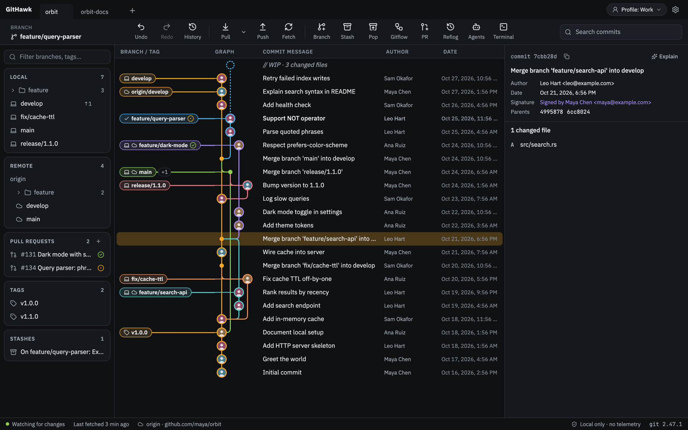
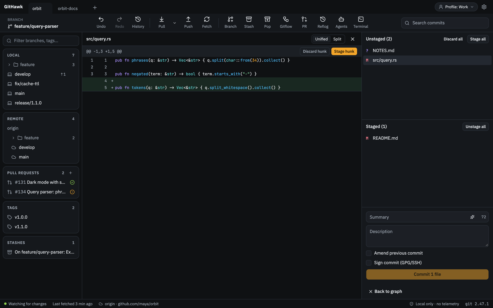
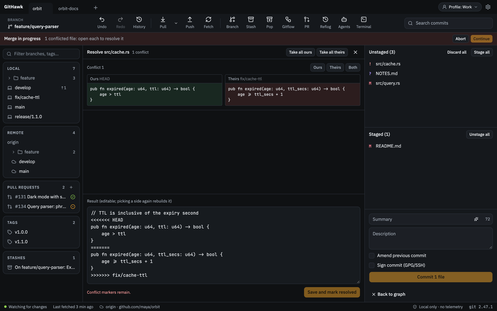

<p align="center">
  
</p>

<h1 align="center">GitHawk</h1>

<p align="center">
  A fast, local-first Git client for macOS, Windows and Linux.<br>
  Free, open source, no account, no telemetry.
</p>

<p align="center">
  <a href="https://github.com/masitings/githawk/releases/latest"><b>Download</b></a> ·
  <a href="#build-from-source">Build from source</a> ·
  <a href="CONTRIBUTING.md">Contribute</a>
</p>



## Why GitHawk

- **Light.** Rust and Tauri instead of a bundled browser. The graph is laid out in Rust and drawn on a virtualized canvas, so large histories stay smooth.
- **Real git.** Every change runs your `git` CLI, so hooks, LFS, signing and credential helpers work as they do in your terminal. The command log shows exactly what ran.
- **Undo anything.** Commits, merges, rebases, resets and branch changes can be undone with ⌘Z.
- **Yours.** No sign-in and no server. Tokens live in your OS keychain.

## Features

- **Graph:** drag a branch onto another to merge, rebase or open a pull request; hide, solo and search branches; CI status on branches.
- **Staging:** stage files, hunks or single lines in a unified or split diff with word-level highlights; amend and sign commits.
- **Branching:** interactive rebase, cherry-pick, revert, compare any two commits or branches, Gitflow, and a three-panel conflict editor.
- **Remotes:** GitHub, GitLab, Bitbucket and Azure DevOps (cloud and self-hosted). Clone, push, pull, and review and merge pull requests in the app.
- **Power tools:** command palette (⌘K), reflog, stash, tags, worktrees, submodules, LFS, a built-in terminal and side-by-side coding agent sessions.
- **AI, optional:** commit messages, commit explanations and changelogs with your own Anthropic key or any OpenAI-compatible server, including local ones.

<table>
  <tr>
    <td></td>
    <td></td>
  </tr>
</table>

## Install

Download the installer for your system from [Releases](https://github.com/masitings/githawk/releases/latest). GitHawk uses the `git` on your machine, so install [Git](https://git-scm.com) first. The app updates itself.

The macOS build is signed and notarized. The Windows build is not signed yet; if SmartScreen warns, choose **More info → Run anyway**.

## Build from source

You need [Rust](https://rustup.rs), [Node.js](https://nodejs.org), [pnpm](https://pnpm.io) and the [Tauri prerequisites](https://tauri.app/start/prerequisites/).

```bash
pnpm install
pnpm tauri dev
```

`pnpm tauri build` produces an installer. See [CONTRIBUTING.md](CONTRIBUTING.md) for tests and checks, and [docs/ARCHITECTURE.md](docs/ARCHITECTURE.md) for how the code is organized.

## License

[Apache License 2.0](LICENSE)
