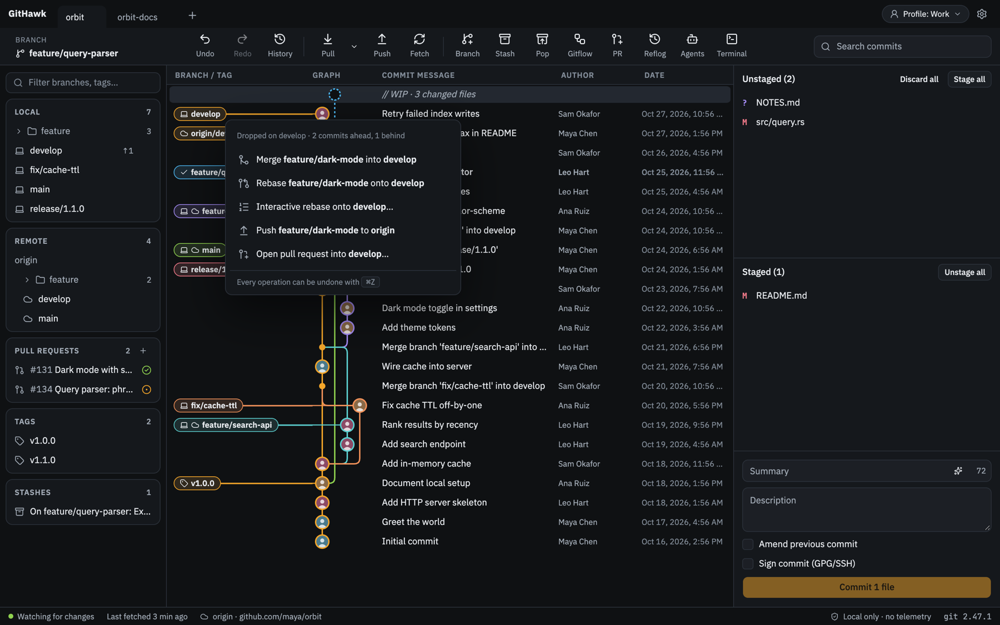
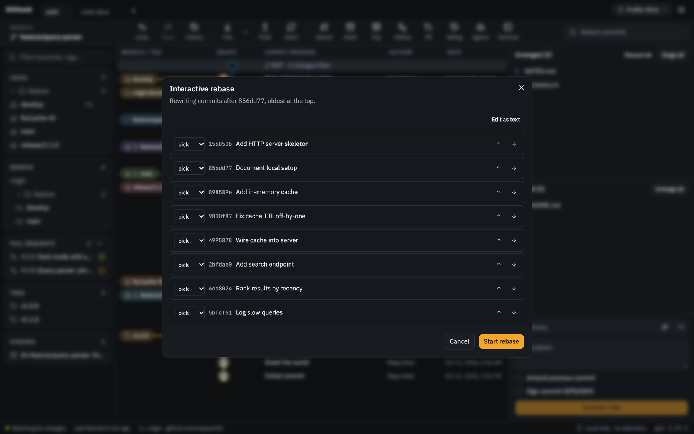
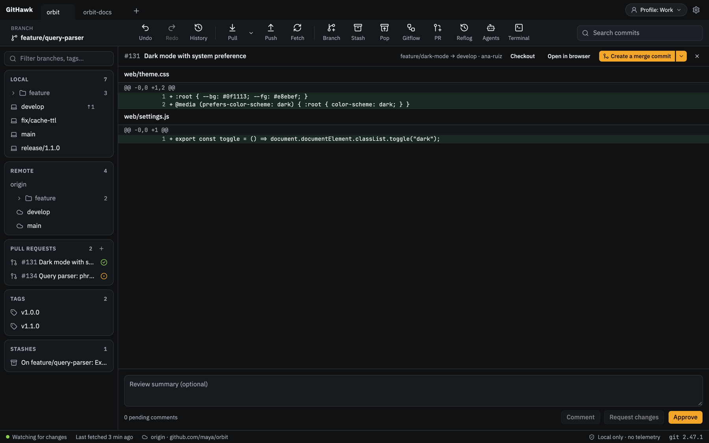
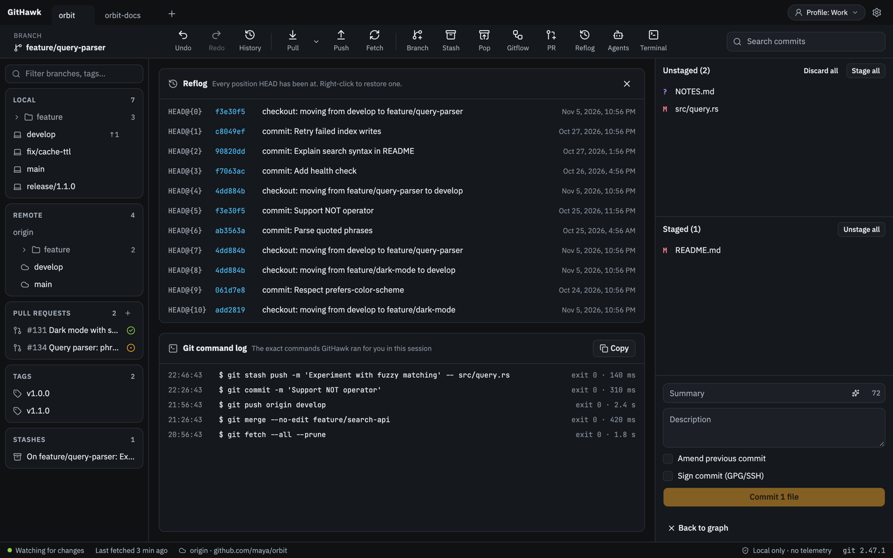
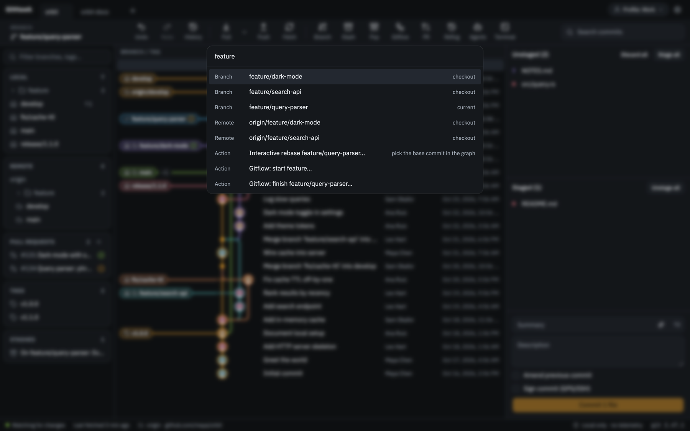
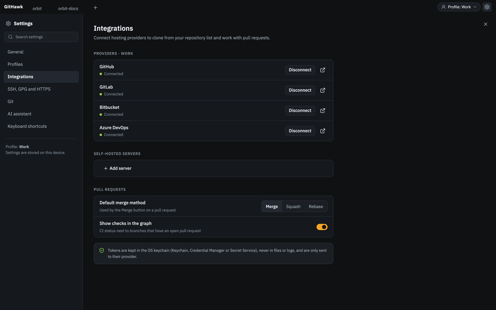
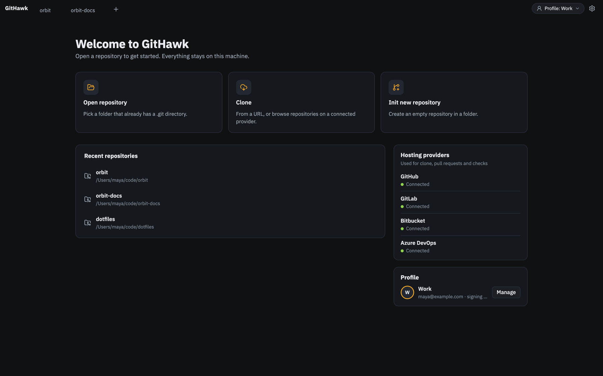
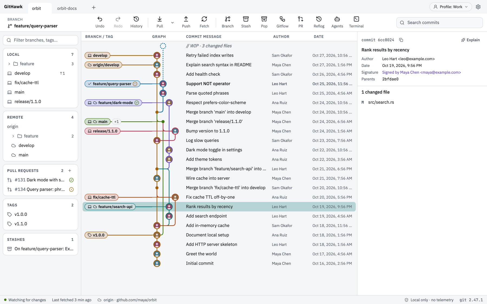

# GitHawk

A fast, local-first Git desktop client built with Rust and Tauri. Every feature is free, there is no GitHawk account, and nothing is sent anywhere except the hosting provider or AI server you choose.


> GitHawk is in early development (v0.1). It has not been released as an installer yet; build it from source to try it.

## Why GitHawk

- **Small and quick.** A Tauri app with a Rust core instead of a bundled browser. Repository data is read with libgit2 and the graph is laid out in Rust, then drawn on a canvas with virtual scrolling.
- **Behaves like your terminal.** Anything that changes a repository runs the real `git` CLI, so hooks, Git LFS, commit signing and credential helpers work exactly as they do on the command line. The command log shows every command GitHawk ran.
- **Local first.** No sign-in, no telemetry. Tokens and API keys live in the OS keychain.
- **Undo for everything.** Commits, merges, rebases, resets and branch changes are recorded in an operation log you can step back through.

## Features

### Commit graph

- Canvas graph with colored lanes, author avatars, merge dots and rounded connectors, virtualized for large histories.
- Branch, remote and tag pills, with a `+N` badge when several refs point at one commit.
- Drag a branch onto another to merge, rebase, interactively rebase, push, or open a pull request. The drop menu shows how far ahead and behind the branches are.
- Double-click a branch to check it out. Double-click a remote branch to sync your local branch with it: fast-forward when behind, or reset (after confirmation) when it has commits the remote doesn't.
- Hide or solo branches, search commits by message, author or SHA, and jump to any ref.
- CI status badges (passed, failed, running) on branches with an open pull request.



### Staging and committing

- Stage or discard whole files, single hunks or individual lines, in a unified or split diff with syntax highlighting.
- Commit with summary and description, amend the previous commit, and sign with GPG or SSH.
- File history and blame for any file.


### Branches, merging and rebasing

- Create, rename, delete, check out and reset branches; cherry-pick and revert one or several commits.
- Interactive rebase with pick, reword, edit, squash, fixup and drop, reordering, or editing the todo as raw text.
- Three-panel conflict editor: ours, theirs and an editable result, with per-conflict and whole-file choices.
- Merge, rebase, cherry-pick and revert in progress show a banner with Continue and Abort.
- Gitflow: initialise, then start and finish feature, release and hotfix branches.




### Remotes and pull requests

- Fetch, pull (merge, fast-forward only or rebase), push with force-with-lease, and background fetch on a timer.
- GitHub, GitLab, Bitbucket and Azure DevOps, plus self-hosted GitHub Enterprise, GitLab self-managed and Bitbucket Data Center.
- Clone from a URL or from your repository list on a connected provider.
- List open pull requests, create them, review the diff with line comments, approve or request changes, and merge with your default method (merge, squash or rebase).



### History and safety

- Undo and redo any operation from the toolbar or with ⌘Z / ⌘⇧Z.
- Reflog viewer: restore any position HEAD has been at.
- Git command log: the exact commands GitHawk ran, with exit codes, timings and error output.



### Power tools

- Command palette for every action, branch, remote, tag and file (⌘K).
- Customisable keyboard shortcuts.
- Stash, tags, worktrees, submodules and Git LFS.
- Built-in terminal panel.
- Agent sessions: run several coding agents (Claude Code, Codex, Aider, …) side by side, each on its own branch and worktree, with live status and changed-file counts.
- AI assistant with your own Anthropic key or any OpenAI-compatible server (OpenAI, Ollama, LM Studio): commit message suggestions, commit explanations and changelogs between tags. A diff is only sent when you press the button.
- Deep links: `githawk://open?path=/path/to/repo&ref=main` opens a repository at a branch or commit.



### Settings

- Profiles with their own author identity, signing key and provider tokens, switchable from the tab bar.
- SSH keys: list, generate ed25519 keys and pick one for signing. GPG keys and the HTTPS credential helper.
- Global git settings: default branch, pull behaviour, prune on fetch, automatic upstream, signing by default and line endings.
- Dark, light or system theme.







## Keyboard shortcuts

On Windows and Linux, ⌘ is Ctrl. Every shortcut can be changed in Settings → Keyboard shortcuts.

| Action | Shortcut |
| --- | --- |
| Command palette | ⌘K |
| Find file | ⌘P |
| Undo / redo | ⌘Z / ⌘⇧Z |
| Fetch | ⌘⇧F |
| Pull | ⌘⇧L |
| Push | ⌘⇧U |
| Create branch | ⌘B |
| Stash / pop stash | ⌘⇧S / ⌘⇧O |
| Toggle terminal | Ctrl+` |
| Reflog and command log | ⌘⇧R |
| Agent sessions | ⌘⇧A |
| Toggle sidebar | ⌘⇧B |
| Search commits | ⌘F |
| Settings | ⌘, |

## Build from source

You need [git](https://git-scm.com), [Rust](https://rustup.rs) (stable, edition 2024), [Node.js](https://nodejs.org) and [pnpm](https://pnpm.io), plus the [Tauri prerequisites](https://tauri.app/start/prerequisites/) for your OS.

```bash
pnpm install
pnpm tauri dev
```

Build an installer for your platform:

```bash
pnpm tauri build
```

Run the tests:

```bash
cargo test --workspace
pnpm test
```

## Project layout

| Path | What it holds |
| --- | --- |
| `crates/githawk-core/` | Git library: graph layout, repository reads (libgit2), the allowlisted operations that run the git CLI, the undo log, interactive rebase and line staging |
| `src-tauri/` | Tauri app: IPC commands, file watcher, terminal, hosting providers, AI, SSH/GPG keys |
| `src/` | React 19 + TypeScript UI, styled with Tailwind CSS v4 and shadcn/ui |
| `docs/` | Product requirements and screenshots |

## Privacy

GitHawk has no telemetry and no server. It talks only to the git remotes you use, the hosting providers you connect, and the AI server you configure. Tokens and API keys are stored in macOS Keychain, Windows Credential Manager or the Secret Service on Linux, never in files or logs.

## License

Licensed under the [Apache License 2.0](LICENSE).
